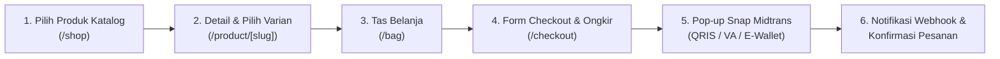

# DOKUMENTASI ALUR TRANSAKSI PEMBAYARAN MIDTRANS
**SEVAYA STUDIO (PT / CV SEVAYA INDONESIA)**  
*Dokumen Pendukung Aktivasi Payment Gateway Midtrans Production*

---

## 1. Informasi Umum Merchant

| Parameter | Keterangan |
| :--- | :--- |
| **Nama Brand / Merchant** | **SEVAYA STUDIO** |
| **Website Resmi** | [https://sevaya-studio.com](https://sevaya-studio.com) |
| **Kategori Usaha / Industri** | Fashion & Apparel (Busana Muslimah / Abaya Modern) |
| **Model Bisnis** | Direct-to-Consumer (B2C / Retail E-Commerce) |
| **Mata Uang Transaksi** | IDR (Rupiah Indonesia) |
| **Metode Integrasi Midtrans** | **Midtrans Snap Popup Modal (Redirect / Embedded Dialog)** |
| **Channel Pembayaran yang Diaktifkan** | QRIS (Semua E-Wallet & Mobile Banking), Bank Virtual Account (BCA, Mandiri, BNI, BRI, Permata), GoPay, ShopeePay |
| **Akun Uji Coba (Dummy Account)** | Email: `tester.midtrans@sevaya-studio.com` Password: `DemoPassword2026!` *(Website juga mendukung Guest Checkout tanpa login)* |
| **Kontak Operasional** | Email: `info@sevaya-studio.com` WhatsApp Layanan Pelanggan: `+62 812-XXXX-XXXX` |

---

## 2. Ringkasan Alur Pembelian & Pembayaran (Diagram)

---

## 3. Langkah-Langkah Transaksi Step-by-Step

### Langkah 1: Eksplorasi Katalog & Pemilihan Produk
* **URL:** `https://sevaya-studio.com/shop`
* **Penjelasan:**  
  Pelanggan mengunjungi etalase publik Sevaya Studio untuk melihat koleksi abaya, linen series, dan hijab. Setiap produk menampilkan foto resolusi tinggi, harga transparan dalam Rupiah (IDR), dan status stok.

> **[AREA TANGKAPAN LAYAR / SCREENSHOT 1]**  
> *(Tempelkan screenshot halaman katalog toko yang menampilkan produk-produk Sevaya)*

---

### Langkah 2: Pemilihan Varian Ukuran & Warna pada Halaman Produk
* **URL:** `https://sevaya-studio.com/product/abaya-plum-riverside-silk`
* **Penjelasan:**  
  Pelanggan masuk ke halaman detail produk (Product Detail Page - PDP), memilih varian warna (swatch kain), panduan ukuran (Size S/M/L/XL), serta menentukan kuantitas pembelian. Kemudian menekan tombol **"Tambah ke Tas"** *(Add to Bag)*.

> **[AREA TANGKAPAN LAYAR / SCREENSHOT 2]**  
> *(Tempelkan screenshot halaman detail produk dengan pilihan warna/swatch dan tombol beli)*

---

### Langkah 3: Peninjauan Tas Belanja (Shopping Bag)
* **URL:** `https://sevaya-studio.com/bag`
* **Penjelasan:**  
  Pelanggan meninjau produk yang telah dimasukkan ke dalam tas belanja. Halaman ini memperlihatkan foto thumbnail produk, rincian varian warna yang dipilih, harga satuan, kalkulasi subtotal belanja, serta estimasi proteksi pengemasan sebelum melanjutkan ke pembayaran. Pelanggan menekan tombol **"Lanjut ke Checkout"**.

> **[AREA TANGKAPAN LAYAR / SCREENSHOT 3]**  
> *(Tempelkan screenshot halaman keranjang belanja / bag yang menampilkan subtotal)*

---

### Langkah 4: Pengisian Informasi Pengiriman & Kalkulasi Ongkir
* **URL:** `https://sevaya-studio.com/checkout` *(atau `/test-checkout`)*
* **Penjelasan:**  
  Pelanggan melengkapi rincian data pemesanan:
  1. **Data Pelanggan:** Nama lengkap, email aktif, nomor telepon/WhatsApp.
  2. **Alamat Pengiriman:** Provinsi, Kota/Kabupaten, Kecamatan, Kode Pos, dan alamat jalan lengkap.
  3. **Pilihan Kurir & Tarif:** Sistem secara otomatis menghitung tarif ongkos kirim resmi kurir ekspedisi (JNE, SiCepat, J&T).
  4. **Ringkasan Tagihan Total:** Harga produk + Ongkir kurir.  
  Setelah memastikan semua data valid, pelanggan menekan tombol **"Bayar Sekarang dengan Midtrans"**.

> **[AREA TANGKAPAN LAYAR / SCREENSHOT 4]**  
> *(Tempelkan screenshot formulir pengisian nama, alamat kirim, rincian biaya ongkir, dan tombol bayar)*

---

### Langkah 5: Pemanggilan Pop-Up Pembayaran Resmi Midtrans Snap
* **Penjelasan Teknis:**  
  Sistem backend Sevaya Studio melakukan *handshake* dengan Midtrans API (`/api/payment/snap-token`) untuk meng-generate token transaksi yang aman. Dialog modal resmi **Midtrans Snap** muncul di layar tanpa me-redirect pelanggan keluar dari platform secara kasar.
* **Metode Bayar yang Tersedia:**
  * **QRIS:** GoPay, OVO, Dana, LinkAja, ShopeePay, BCA Mobile, Livin Mandiri, dll.
  * **Virtual Account Bank (Otomatis):** BCA VA, Mandiri Bill, BNI VA, BRI VA, Permata VA.
  * **E-Wallet:** GoPay & ShopeePay App Redirect.

> **[AREA TANGKAPAN LAYAR / SCREENSHOT 5]**  
> *(Tempelkan screenshot pop-up Midtrans Snap yang sedang terbuka menampilkan pilihan QRIS / VA beserta nominal harga)*

---

### Langkah 6: Notifikasi Pembayaran Berhasil & Konfirmasi Pesanan (Order Confirmation)
* **URL:** `https://sevaya-studio.com/order-confirmation`
* **Penjelasan:**  
  1. Setelah pembayaran diselesaikan oleh pelanggan, server Midtrans mengirimkan notifikasi *Server-to-Server Webhook* (`/api/webhooks/midtrans`) yang mengubah status pembayaran pesanan menjadi `settlement` (Lunas).
  2. Pelanggan secara otomatis dialihkan ke halaman **Konfirmasi Pesanan**.
  3. Halaman ini memuat **Nomor Pesanan (Order ID)**, rincian produk yang dibeli, alamat tujuan pengiriman, metode pembayaran yang digunakan, serta tombol tautan pelacakan pengiriman.
  4. Sistem juga mengirimkan bukti invoice transaksi ke alamat email pelanggan.

> **[AREA TANGKAPAN LAYAR / SCREENSHOT 6]**  
> *(Tempelkan screenshot halaman konfirmasi pesanan berhasil / invoice order)*

---

## 4. Kebijakan Operasional Toko (Compliance Midtrans)

1. **Kebijakan Pengembalian & Penukaran (Return & Refund Policy):**  
   Pengembalian produk atau penukaran ukuran dilayani maksimal 3 (tiga) hari kerja sejak pesanan diterima pelanggan dengan syarat tag produk masih utuh dan belum digunakan. Pengembalian dana dilakukan melalui transfer bank atau saldo e-wallet pelanggan dalam 1-3 hari kerja.
2. **Kebijakan Pengiriman (Shipping Policy):**  
   Pesanan yang terkonfirmasi lunas sebelum pukul 15:00 WIB dikemas dan diserahkan ke pihak ekspedisi pada hari yang sama. Estimasi waktu pengiriman berkisar antara 1-3 hari kerja untuk wilayah Jabodetabek dan 2-5 hari kerja untuk luar pulau Jawa.
3. **Kebijakan Privasi (Privacy Policy):**  
   Semua data pribadi pelanggan (nama, alamat, kontak) dienkripsi dengan standar TLS/SSL dan hanya digunakan untuk kepentingan pengiriman dan notifikasi pesanan. Sevaya Studio tidak pernah menyimpan data kredensial finansial atau PIN bank pelanggan.

---

*Disusun dengan penuh tanggung jawab oleh Tim Operasional SEVAYA STUDIO.*  
*Tanggal: 25 Oktober 2026*  
*Website: https://sevaya-studio.com*
